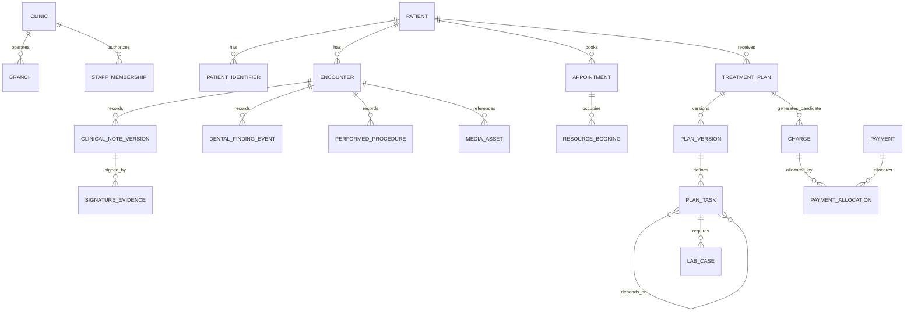

# 02 — Domain model, bounded contexts, state machines and invariant catalog

**Status:** proposed domain architecture; requires review with licensed dentist, practice manager and accounting lead. Avoid direct FHIR-as-database modeling until implementation profiles have been defined.

## 1. Architecture topology

Use a **modular monolith** (not 12 microservices) with bounded contexts grouped into four independent transaction units. Python/FastAPI + SQLAlchemy/PostgreSQL is a reasonable default, but domain constraints should be portable. Each context owns its tables and exports use-cases/contracts; other contexts never mutate its data directly.

| Context | Owns | May reference without taking ownership |
|---|---|---|
| Tenant/identity | Organization, ClinicBranch, Membership, PractitionerCredential, AccessPolicy | Global identity provider account |
| Patient registry | Patient, PatientIdentifier, RelatedPerson, patient-merge history | Organization/branch |
| Scheduling | Appointment, Resource, Shift, Booking, waitlist | Patient, clinician/branch, procedure type |
| Clinical | Encounter, Finding, NoteVersion, ClinicalDocument, SignatureEvidence, ProcedureRecord, ImageLink | Patient, clinician, encounter-scoped treatment phase |
| Odontogram | DentalFinding events, ToothReference, ToothSurface, render snapshots | Encounter, clinical assessment |
| Treatment journey | Plan, PlanVersion, Phase, Task, Dependency, ClinicalApproval, Progress | Encounter, scheduler, billing, lab |
| Laboratory | Case, item, file manifest, milestones, receipt/revision | Plan step, authorized lab partner |
| Inventory | SKU, lot, stock ledger, stock reservations/consumption | Procedure ID, branch |
| Revenue cycle | Estimate/Version, Contract, Charge, InvoiceReference, Payment, Allocation, Refund | Plan/service, Patient billing account |
| Patient communication | Consent, notification template, message job, delivery evidence | Patient contact, approved follow-up order |
| Audit/integration | Request log, audit/event journal, outbox/inbox, exports | Stable object IDs and actor |

**No double booking across modules:** Scheduling owns authoritative resource reservations. Treatment requests a booking but does not directly assign a chair. Clinical owns record authoring; a treatment step can be marked clinically completed only through a clinician-authorized event, not a payment or date.

## 2. Aggregate boundaries (write consistency)

- `Encounter` = one clinical visit/episode with status and sealed/documented artifacts. It owns clinical operations associated with the visit but does not own longitudinal patient identity or invoices.
- `ClinicalDocument` = signed snapshot and subsequent addenda; original signing object immutable.
- `TreatmentPlan` = versioned collection of proposed/approved phases/tasks. Approval applies to exact plan version. New treatment direction => a new version, old plan preserved.
- `Appointment` = patient visit intention; resources are assigned atomically through `Booking` rows.
- `RevenueAccount` = charges and immutable payment allocation entries; no direct mutation of `balance_due` as source of truth.
- `LabCase` = external handoff + receive + revision; does not own patient's health record.
- `InventoryLot` = append-only movements and balance integrity, reservations independent.
- `ConsentDocument` = exactly what was disclosed/agreed, by whom, through which method, at which time, under which template version.

## 3. Conceptual ERD



## 4. State machines and permitted transitions

### Encounter
`planned → checked_in → in_progress → documentation_pending → completed → archived`; alternatives `cancelled`, `entered_in_error` with approval/audit. Avoid permanent deletion. `completed` requires clinician-defined mandatory record checks, but should not silently sign documentation.

### Clinical document
`draft → ready_for_signature → signed → addended`, with `rejected` or `voided_with_reason` workflows. **Signed version never mutated**; addendum is a new immutable document linked to the signed original and reason for correction. `signed` only via validated identity and e-sign provider under clinic-approved policy. Hash alone is not lawful signature.

### Treatment plan
`draft → proposed → approved → active → completed | cancelled`, plus `superseded` when approved version replaced. At most one *active* version for a plan at a time. A new version may add future tasks without rewriting historical performed tasks; clinician must explicitly approve changes affecting clinical care.

### Plan task
`blocked → ready → scheduled → in_progress → completed`; allowed alternates `cancelled`, `deferred`, `needs_review`. Clinical tasks may require clinician event to reach completed. Workflows can revisit a phase by creating new task instances, **not by corrupting historical completion**.

### Lab case
`created → accepted_by_lab → in_production → shipped → received → verified`; with `needs_correction`, `cancelled`, `lost` and revision cycle. Receiving a package is different from clinician quality acceptance.

### Financial charge
`draft → approved → posted → settled | adjusted`, with reversal entries. A refund is not negative stored in the original payment row; it is an explicit financial reversal / separate event linked to payment. Payment accounting depends on clinic financial policy and applicable invoicing requirements.

## 5. Critical invariants (INV-*)

| ID | Invariant | Enforcement and test |
|---|---|---|
| INV-001 | Clinical record always belongs to correct clinic, patient, encounter | composite FK/ownership checks + cross-tenant tests |
| INV-002 | Patient identity may be uncertain; two patients cannot merge automatically | duplicate candidate queue, human merge action, reversible provenance |
| INV-003 | Clinic contact phone may be shared by relatives; not unique | no global unique phone constraint |
| INV-004 | Signed note content is immutable | DB append-only version records; denial on UPDATE; tamper-detection on restore |
| INV-005 | Addendum must identify original signed version, author, reason | FK + audit + signature evidence |
| INV-006 | Clinical authorship != administrative operator | `author_practitioner_id` explicit; no spoofing |
| INV-007 | Planned procedure != performed procedure | independent records and status-driven authorization |
| INV-008 | Financial settlement != clinical completion | no automatic cross-context status equivalence |
| INV-009 | No overlapping active bookings for same chair/clinician/equipment | exclusion constraint + transaction, not only UI check |
| INV-010 | All resources for one appointment booked atomically | one transaction; rollback on any conflict |
| INV-011 | Appointment cancellation doesn't remove medical history | cancel booking only; preserve encounter/audit |
| INV-012 | Plan approval binds exact plan-version hash | signed/approved version immutable; subsequent change new version |
| INV-013 | Tasks cannot complete with unmet safety prerequisites | reviewed task policy and clinician override with reason if allowed |
| INV-014 | Lab partner sees minimum necessary data only | case-specific limited token / scoped ACL |
| INV-015 | Inventory quantities derive from movements | ledger, no direct unsourced balance correction |
| INV-016 | Money stored in integer VND or Decimal with explicit currency | exact arithmetic, no binary floats |
| INV-017 | Refund/charge adjustment never silently overwrites source transaction | new reversing entries, audit |
| INV-018 | Retention beats self-service deletion where legally required | per-record legal hold/retention gate; owner approval |
| INV-019 | Backup contains DB + images + required keys and signatures in consistent snapshot | end-to-end restore drill |
| INV-020 | AI cannot finalize clinical record or execute unapproved action | allowlisted tools, RBAC, clinician review |
| INV-021 | Tenant B's patient data never appears in A's search, export, AI context or media links | adversarial isolation tests |
| INV-022 | Signed document references exact media and structured data versions | snapshot manifest, hashes, no late object replacement |
| INV-023 | All external side effects use idempotency and retry-safe outbox | dedup event key, at-least-once delivery awareness |
| INV-024 | Patient consent for treatment, privacy and marketing are separate | distinct purpose/form/version and revocation semantics |

## 6. Time and identifiers

- Use UUID/ULID as opaque IDs; avoid embedding clinic name or personal ID in identifiers.
- Events timestamped in UTC with offset-aware timestamps. Appointment display and scheduling use `Asia/Ho_Chi_Minh` with explicit timezone. `date` for date-of-birth must not be timezone-shifted.
- Separate `occurred_at`, `recorded_at`, `signed_at`, `effective_at`, and `received_at`. Backdated care documentation should retain actual documentation time plus clinically attested occurrence time.
- Procedure codes, diagnoses, tooth notation and templates versioned and sourced, not unstructured label strings in core references.
- Tooth code scheme `FDI/ISO 3950` when approved for clinic; tooth/surface observations are *temporal events* and support primary/permanent dentition.

## 7. API command/query design (illustrative)

```
POST /v1/clinics/{clinic}/patients
GET  /v1/clinics/{clinic}/patients/{patientId}
POST /v1/clinics/{clinic}/patients/{patientId}/encounters
POST /v1/clinics/{clinic}/encounters/{encounterId}/notes/drafts
POST /v1/clinics/{clinic}/clinical-documents/{documentId}/request-signature
POST /v1/clinics/{clinic}/clinical-documents/{documentId}/addenda
POST /v1/clinics/{clinic}/appointments
POST /v1/clinics/{clinic}/treatment-plans/{planId}/versions
POST /v1/clinics/{clinic}/treatment-plans/{planId}/approve-version
POST /v1/clinics/{clinic}/lab-cases/{caseId}/receive
GET  /v1/clinics/{clinic}/patients/{patientId}/timeline
GET  /v1/clinics/{clinic}/patients/{patientId}/record-exports
```

Every command requires a server-side-derived clinic scope, actor identity, business role and, where appropriate, patient-level access. Require `Idempotency-Key` on side effects and `If-Match`/version for destructive state transitions. The client cannot self-assert clinic membership or signer identity.

## 8. Transaction and event propagation

**Synchronous transaction boundary:** create appointment + required resource bookings; sign exact document + record signature outcome; issue one charge+related ledger entry; perform a patient merge after human approval.

**Async boundary:** send reminders, update read-model timeline, generate PDF, export FHIR, relay lab messages, recalculate management KPIs. Use a transactional outbox committed in the same database transaction as the source event. Deliver at least once; consumers deduplicate by `(event_id, consumer_name)`.

Do not require exactly-once distributed message semantics. Prefer idempotent retry and per-entity sequence checks.

## 9. Template versioning: dual paths

- **Clinical schema**: typed, normalized, reusable across procedures.
- **Regulatory render/export**: maps typed fields + approved signature and document snapshots to an applicable version of 16/BV-01 or other legally required form.

Store: form version and source law, mapping revision, renderer version, source data version, signed output hash. Prior approved records continue rendering reproducibly even when template updates.

## 10. FHIR/DICOM as interoperability adapters

Do not make the relational domain store exactly one JSON field per FHIR resource. Build internal aggregates and controlled transformation layers. Typical mapping (validate profiles): Patient, Practitioner, Organization, Appointment, Encounter, Condition, Observation, Procedure, CarePlan, DocumentReference, Provenance and AuditEvent. **FHIR R4 Consent mainly models privacy directives**; treatment consent cannot be assumed legally implemented merely by persisting an R4 Consent resource. Bind to signed original artifact and governing policy.

DICOM: source imaging archive/PACS and DICOMweb adapter when equipment supports it; Orthanc and OHIF are candidate building blocks, subject to device compatibility and security validation. Include correct patient identifier reconciliation, modality/worklist support where applicable, and image provenance. Import of a DICOM object must not silently create a new clinical finding.

## 11. Algorithm design notes

### Appointment scheduling
Use strict database-level nonoverlap reservation for clinician/chair/equipment. For rescheduling recommendations use CP-SAT or hybrid heuristics; objective combines wait time, utilization, overtime, disruption and clinician-specific priorities. A solver result is advisory until validated and committed via transaction. No solver results directly override a confirmed patient appointment.

### Plan dependency engine
Represent planned milestones as an acyclic dependency graph per version; validate cycles on edits, calculate blocked/ready tasks topologically. **Clinical reality has loops**: repeats and re-evaluations create new task instances or versioned branch decisions. Never force the actual patient trajectory into a one-way inflexible DAG.

### Reconciliation
Payment allocations to charges use a ledger. An accepted plan, a performed procedure, a billed charge and a received payment are four independent facts; relationships are explicit and reviewable. Revenue reports must distinguish gross charges, invoiced, received, refunded, outstanding and planned treatment estimates.

### Clinical AI
Input: minimized, authorized context; output: draft only with source references and recognized uncertainty. Tool gateway allowlists read operations; write tools require user review and the same backend policy check as human UI. No direct unrestricted SQL / shell / browsing to patient data.

## 12. Anti-patterns banned

- One giant `patients` table with `medical_history TEXT` and all treatments as JSON blob.
- Overwriting the latest odontogram instead of recording dated findings.
- Auto-generating signed medical records from AI summaries.
- Using localStorage, PDF file names or phone numbers as patient identity source of truth.
- Direct UI-to-DB calls bypassing server authorization.
- Deleting history on cancellation, staff departure, change of clinic subscription.
- Updating financial balances without ledger entries.
- Using an event bus as an excuse to remove transactional safety from the same database.
