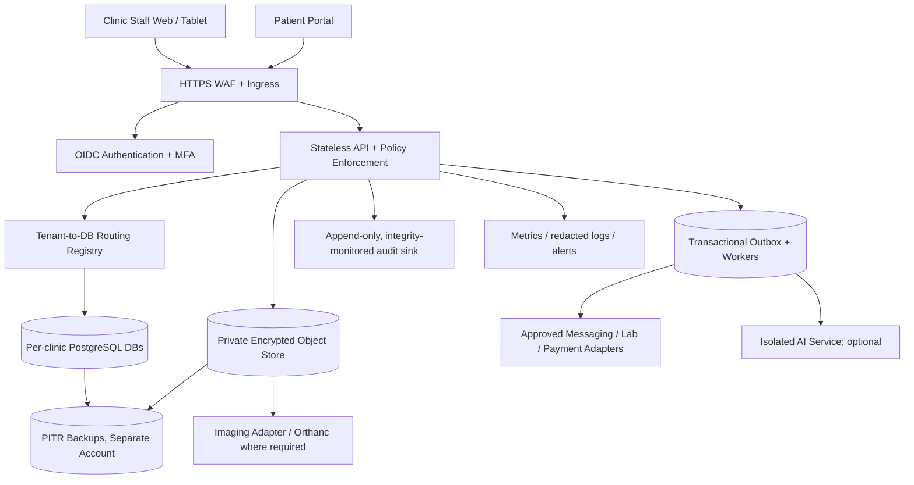

# 03 — Deployment topology, privacy, security, continuity and operations

**Status:** design recommendation for pilot and commercial product. No hosting provider or data center has been audited; do not equate 'Vietnam hosting' or an ISO certificate with compliance. Confirm applicable PDPL/EMR requirements with counsel and Sở Y tế.

## 1. Requirements and threat model

### Functional NFRs
- Browser workflow usable at reception desktop and clinician tablet; responsive patient portal.
- Database transactions consistent even under concurrent booking, billing and signatures.
- App remains clinically usable when AI is unavailable. Graceful degradation must not produce false completed records.
- No cross-clinic patient access; explicit branch controls within a clinic organization.
- Exports preserve record identity, source, author, timestamps, signature evidence, file hashes and complete reference linkage.
- Clinic can retrieve data upon contract termination according to clinic rights and legal retention obligations.
- Signed document and attached media must remain verifiable after schema upgrades and disaster recovery.

### Threat actors/assets
Assets: patient identity, health and imaging records, clinician signatures, payment records, access logs, lab files, and platform signing keys. Threats: stolen laptops, ransomware, cloud credential theft, compromised employee accounts, API horizontal privilege escalation, cross-tenant query leaks, lost media, insider browsing, forged clinical confirmation, compromised update pipeline, prompt injection and data extraction from model tools.

## 2. Deployment choice and trade-off matrix

| Model | Strongest fit | Advantages | Risks |
|---|---|---|---|
| Single clinic onsite | very connectivity-constrained clinic | local control, isolated service | unmaintained servers, lost backup, harder patching, device access |
| Multi-tenant shared DB | many small clinics, mature operational discipline | low provisioning overhead, efficient compute | complex RLS/auth proof, cross-tenant incident blast radius |
| Dedicated DB per clinic (shared app, logical separation) | **initial 1–20 clinics** | cleaner tenant backup/restore, less shared SQL exposure, per-clinic migration control | connection pools, migrations, operations per tenant |
| Fully dedicated app + DB | chain or premium/contractually constrained facility | control and isolation | high cost, slow coordinated upgrades |
| Hybrid cloud + on-site connector | imaging equipment needs onsite DICOM/data capture | cloud UX, local device interoperability | sync, identity binding, incident debugging, upgrade complexity |

**ADR suggestion:** Start with dedicated clinic DB (or schema isolation if operationally necessary) + shared stateless application control plane, regional object storage and audited deployment. Build tenancy router early, but **do not implement distributed offline clinical writes** until justified by actual clinic connectivity and tested conflict resolution.

Branches and legal clinic ownership are not automatically the same as a tenant. Model separate `organization_id` (commercial customer), `clinic_id` (licensed operating facility) and `branch_id` (operating location) with verified ownership/permissions. A chain spanning multiple licenses may require explicit governance and cross-facility data-sharing rules.

## 3. Reference cloud topology

Control plane stores clinic business metadata and tenant routing; no raw patient records or unredacted prompts. Clinical-plane databases encrypted in transit/at rest; DB networking private. Files and signatures referenced via manifest. Patient portal authorization implemented independently from staff permissions.

### Minimum infrastructure services
- Private virtual network/VPC, ingress TLS (with managed certificates), WAF/rate-limiting; DB and object storage not publicly addressable.
- App instance replicas / health checks; managed PostgreSQL with PITR and backup; object storage versioning / object lock as necessary.
- Asynchronous job queue with dead-letter, retry+idempotency, inbound/outbound webhook verification.
- Dedicated secrets manager and KMS, key rotation policy and access logs.
- Immutable or off-domain audit anchor; regular integrity verification; redacted metrics.
- Deployment pipeline with signed artifacts, SBOM and secrets scanning; no direct CI access to production patient data.
- Independent recovery account/project and regular automated + manual restore verification.

## 4. Data and document security

### Encryption
TLS (current, approved versions) in transit. Database/volume and object storage encrypted at rest. For sensitive attributes (identity, clinical text) consider envelope encryption with tenant-specific data keys and centralized KMS; check query impact on search and indexing. Encrypted backups with key recovery procedure and periodic rotation. Ensure administrative support workflows minimize PHI access.

### Access model
Use RBAC + ABAC: `actor`, `clinic`, `branch`, `patient relationship`, `purpose`, `clinical assignment`, `document status`, `time/approval`. Enforce on API and data access (defense in depth, potentially PostgreSQL RLS). Never trust tenant ID from URL alone. MFA for privileged users; session revocation, risk-based step-up for signature/exports. Distinguish clinical approval identity from login session authentication.

### Media and imaging
Original files immutable/versioned, server-generated content hashes and MIME validation. Each object contains tenant/patient/encounter ownership metadata securely outside user-controlled filename. Signed URLs expire and are scoped; no public bucket. DICOM adapter should reconcile real identifiers, never trust `PatientName` blindly. File access must be audited and subject to RBAC/ABAC.

### Clinical document signing
Generate canonical snapshot + manifest referencing exact author-approved content and attachments. Use legally appropriate signature/confirmation method selected after legal assessment, preserve signature validation evidence and certificate/provider metadata. On amendment, create linked new document; original signed content remains intact. An app-internal document hash alone is insufficient as legally effective signing.

### Audit architecture
Record actor, action, object, purpose/context, timestamp, before/after digests and request ID without embedding PHI in audit log. Append-only privileges, off-DB copies and periodic signed digest anchoring; investigate missing sequence IDs or hash discontinuities. **A local SHA256 chain is tamper-evident only against some attackers; it is NOT an absolute guarantee against DB administrators without independent anchor/controls.**

### Privacy processing
Official Vietnamese PDPL Law 91/2025/QH15 and Decree 356/2025/NĐ-CP effective Jan 1 2026. Clarify clinic/vendor roles (controller/processor or joint roles), patient notices, legal basis, sensitive health data processing, retention, rights and incident obligations with counsel. Isolate marketing opt-in from medical treatment records. Data used for model training needs separate review; default **no training on patient data**.

## 5. Data residency and regulatory scope

TT13 mandates security and EMR requirements. Technical guidance Công văn 365 describes deployment at healthcare facility or cloud in Vietnam and recommends cloud for primary-care institutions; legal status of each clause and whether region must be domestic should be confirmed with counsel. Choose a qualified Vietnam-region provider for pilot where feasible, but **hosting in-country is not alone sufficient compliance evidence**. Third-party messaging, AI inference, signature and remote support may entail other data transfers; document egress and contracts.

## 6. Operational SLOs — hypotheses, not guarantees

| Metric | Pilot design target | Required proof |
|---|---|---|
| Interactive API availability | >=99.9% after stable production phase | synthetic checks, alerting, incident reports |
| P95 routine API | <=400ms within target region | realistic synthetic load tests |
| P95 patient chart render | <=2 seconds with normal metadata | representative workstation/network test |
| RPO | <=15 min (clinic clinical DB and media), subject to design | failure simulation, PITR + object-version consistency |
| RTO | <=4 hours for declared disaster event | full test restore with clinical attachments and signing keys |
| Backup recovery | complete integrity of DB, media, provenance and signature evidence | monthly restore drills and signed checklist |
| Data retention | based on current law and document type | signed classification table from counsel |
| Audit ingestion | every sensitive access and state change represented | adversarial testing, periodic sample reconciliation |

**Critical nuance:** A PostgreSQL PITR at T+10min does NOT guarantee object-store files from T+10min exist or are recoverable. Need storage manifests, versioning and coordinated snapshot/reconciliation. Likewise, loss of KMS keys makes otherwise healthy backups unusable. RPO/RTO must be measured across the whole patient record, not SQL alone.

## 7. Offline operation decision

Do not build true offline-first bidirectional clinical edit sync in MVP. It introduces potentially irreconcilable conflicting clinical versions/signatures. Instead:
1. Detect outage and prevent unsafe confirmation of incomplete writes.
2. Provide a documented business-continuity paper/emergency workflow approved by the clinic, without claiming paper is automatically compliant substitute.
3. After restoration, import/backfill with real occurred-time + recorded-time + identified staff approval; preserve provenance.
4. Support narrowly scoped read-only cached data only after evaluating local device theft, expiry, consent and data correctness.
5. Consider local edge gateway for imaging only when necessary, with authenticated controlled transfer to cloud.

## 8. Deployment pipeline and environments

- `dev`: synthetic data and mocks only; local Compose for Postgres/minio/queue.
- `staging`: no production patient data; load and failure injection; separate identity/signing tests.
- `pilot`: controlled clinic deployment with legally reviewed scope, named on-call staff, backup/restore drill and migration dry run.
- `production`: independent release sign-offs (engineering, clinical, security/legal), canary release, rollback, observability.

CI: type checks, unit tests, migration rehearsal, SAST/secret scans, dependency/license audit, fuzz tests, tenant isolation, authorization negative tests and backup/restore integration. Never silently deploy schema changes that alter signed document representation or old form mappings.

## 9. Incident runbook

1. Detect and classify: data corruption, unauthorized access, signature mismatch, lost imagery, ransomware, cloud outage.
2. Restrict affected feature/tenant and preserve redacted evidence; avoid indiscriminate deletion.
3. Determine scope (patient/clinic, dates, objects, exposed permissions), use independent audit evidence.
4. Escalate to clinic accountable owner, security, DPO/legal counsel and relevant authorities per actual obligations.
5. Restore only after integrity verification and formal clinical acceptance; reconcile appointments/documents/payments and media.
6. Notify affected parties where required; record root cause, fix, regression test and approval.

## 10. Security blockers before patient-data pilot

- Written privacy processing role and clinical data handling agreement.
- Independent verification of exact clinic regulatory and signing requirements.
- Working auth/MFA/access policy and tenant isolation adversarial tests.
- Backup, restore and signature evidence verified end to end.
- Security review of provider, cloud region, data egress, support staff access and retention.
- Patient data cannot be ingested into open AI providers by default.
- Signed deployment/rollback runbooks and clinic incident contact.
- Staff training and clinician-approved clinical documentation forms.
