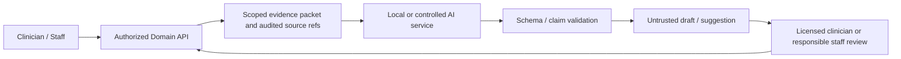

# AI Architecture — assistive, source-grounded and clinician-controlled

## Core premise
AI is optional; chart, calendar, finance, notes and signatures must remain available without a model. Model confidence cannot substitute qualified clinician review or legal authorization. No patient audio, images, clinical text or identifiers may be sent to any model in current demo.

## Proposed AI services
| Service | Inputs (future, only lawfully processed) | Safe output | Mandatory guard |
|---|---|---|---|
| Vietnamese dictation/STT | Consent-governed clinical audio | Transcript draft with timestamps | Review errors on tooth #, allergy, medicine, negation |
| Structured extraction | Transcript + approved local schema | Proposed field values with source spans | Validate schema, never fill missing facts |
| Clinical draft note | Clinician-provided transcript/context | Unauthenticated draft | Doctor edits and signs via legal provider |
| Timeline summarizer | Authorized encounter/note versions | Citation-linked summary | No cross-clinic retrieval or ungrounded diagnosis |
| Operations assistant | Approved workflow tasks, schedule/lab state | Read-only answers, suggested actions | Allowlisted tools; writes need explicit human action |
| Patient communication | Clinician-approved templates and contact status | Draft reminder/response | Privacy/consent, no independent medical advice |
| Resource optimizer | Slots, clinician chairs and limits | Recommended feasible schedule | CP-SAT, server validates booking at commit |
| No-show predictor | Consent-governed history/appointments | Risk score with uncertainty | Fairness, calibration and non-automatic decisions |

## Architecture

## Data governance and model selection
Default no AI. When activated with qualified security/clinical/privacy review: local speech model (Whisper/faster-whisper benchmarking), small quantized instruction model for Vietnamese operations; compare to stronger model if lawful processor contract and data safeguards. Record model version/hash/license, prompt version, consent basis, data minimization, retention/log policy, input source and human review actions. GPU/CPU feasibility must be tested, not asserted.

## Prompting and safety
System tool allowlist. Retrieved notes are **untrusted data**: ignore embedded commands. Models cannot use SQL/database directly, create prescriptions or sign, send communications without authorized workflow, or change billing. For missing source show abstention. Screen labels `AI DRAFT — NOT CLINICALLY VALIDATED` until reviewer explicitly accepts.

## Fine-tuning research plan
Start with manual drafts + deterministic tools; evaluate structured extraction and retrieval, then RAG with approved internal workflow docs; only explore LoRA/QLoRA after held-out benchmark improvement on clinically reviewed de-identified/licensed corpus. No training on real patient data without explicit lawful permission and approved governance. Quantify cost and exact hardware.

## Clinical AI regulation
AI whose intended use is diagnostic, treatment selection or image interpretation requires independent medical-device and AI-risk legal classification, clinical validation and provider liability review. The foundation intentionally excludes such endpoints.
