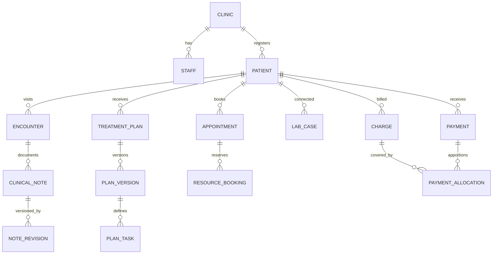

# Domain Architecture: aggregates, invariants and state machines

Version 0.1 · Owner: software/domain architect + dental clinical lead · Status: proposed, not clinically endorsed. Source research preserved at `archive/foundation/02_DOMAIN_MODEL.md`.

## Aggregate responsibility and authority
| Aggregate | Owns | May reference | Must never infer |
|---|---|---|---|
| Patient | Identity, contact & relationships | Clinic, encounters | patient identity from shared phone |
| Appointment | Booked time, resource/attendance | Patient, practitioner, chair, service | treatment performed or bill paid |
| Encounter | Clinical visit and record references | Patient, clinical staff | diagnosis from payment or appointment |
| ClinicalDocument | Note revisions, exact signed snapshot and addenda | Encounter, form | fake signature from a boolean |
| Odontogram | Tooth finding events and projections | Encounter, imaging | clinical condition from color legend |
| TreatmentPlan | Plan versions, phases/tasks/dependencies | patient/encounter, schedule, lab | step done because invoice was paid |
| LabCase | Lab specification and delivery milestones | plan task, media | received=clinically accepted |
| InventoryLot | Movement ledger, reservations/expiry | procedure, branch | stock consumed when reserved |
| RevenueAccount | Charges, payments, allocations/refunds | patient, plan | charge or payment means procedure performed |
| ConsentRecord | Exact disclosure, signer/method/time/version | patient/guardian, document | marketing consent means treatment consent |

## Stable conceptual entity graph

## Domain invariant ledger — authoritative in tests
| ID | Invariant | Enforcement layer | Implemented demo? |
|---|---|---|---|
| INV-001 | All references belong to same owning clinic | service + composite FK | Partly |
| INV-002 | Patient ID immutable; phone not unique | DB + service | Yes |
| INV-003 | Two active bookings for same chair/time impossible | PostgreSQL exclusion + SQLite trigger | DDL + SQLite trigger + 2-connection race test; live PG server pending |
| INV-004 | Clinician, chair and equipment acquired atomically | DB transaction + exclusion | Yes (doctor+chair+equipment atomic rollback) |
| INV-005 | Cancellation frees resource, retains event history | service + audit | Yes |
| INV-006 | Signed clinical artifact immutable | archive + signature verification | Synthetic snapshot + fake receipt verified (`T004`); legal signing gated |
| INV-007 | Draft editing checks expected revision | service + optimistic version | Yes |
| INV-008 | Corrections are addenda with parent link | immutable note & snapshot model | Yes (note + canonical snapshot addenda & `entered_in_error`) |
| INV-009 | Plan reviewed version frozen | version state machine | Yes |
| INV-010 | Task dependencies valid & acyclic within same plan version | FK + DFS cycle check | Yes (multi-dependency DAG + cycle check, `T005`) |
| INV-011 | Task cannot complete before all prerequisites & verified lab | service | Yes (multi-prereq + `requires_verified_lab`, `T005`) |
| INV-012 | Plan copy/reassessment preserves dependency edges & history | version cloning + reassessment | Yes (`T005`) |
| INV-013 | Payment/refund does not mark procedure complete | bounded context separation | Yes (`T005` append-only refunds + timeline separation) |
| INV-014 | Allocation/refund cannot exceed charge or available payment | transaction + DB trigger + locks | Yes (bounded allocation + refund + SQLite trigger + concurrent barrier test) |
| INV-015 | Lab state change follows approved transition matrix | state machine | Yes |
| INV-016 | Delivered lab case is not automatically verified | state machine + task/portal gate | Yes (`NEG-09` enforced on tasks; partner portal blocked from `verified`) |
| INV-017 | Patient/clinic B cannot access patient A via A's credentials | auth/policy tests | Synthetic token + RBAC/ABAC enforced (T001); live OIDC pending |
| INV-018 | DICOM/images must be linked to verified patient and encounter | source manifest + mapping | Not implemented |
| INV-019 | Paper scans retain legacy provenance | migration importer | Yes (`legacy_scan` provenance + `DR-03` forgery block, `T006`) |
| INV-020 | Form and signer evidence specific to exact approved version | signature adapter | Quarantined FormRegistry (`T003`) + FakeSyntheticSignatureProvider (`T004`); legal signer gated |
| INV-021 | Access revocation removes future clinical write permission | identity provider + staff active/token_version | Synthetic staff deactivation + JTI revocation enforced (T001) |
| INV-022 | Missing allergy history != explicit negative | clinical structured types | Tri-state FormRegistry validator enforced (T003) |
| INV-023 | Stock reservation != consumption | inventory ledger | Not implemented |
| INV-024 | Restore must reconcile database with media and signature evidence | full archive manifest | Not implemented (`T010`) |

## Clinical note states
`draft → ready_for_authentication → authenticated → amendment_requested → separate authenticated_addendum`. In code **only `draft → demo_locked`** with SHA256 digest. Hash is an integrity marker, NOT authentication or legal e-signature. Illegal transitions raise conflict.

## Treatment workflow
One plan has immutable numbered versions. A version defines a graph of tasks and prerequisites, no cycles. Executing clinical care may repeat/branch; record fresh task instances/events rather than rewriting history. Demo uses `draft → demo_reviewed` only; eventual clinician approval is a different protected state. Task completion here means **demo administrative status**, never a performed procedure.

## Scheduling concurrency
A time interval is half-open `[start, end)`: appointment ending 10:00 and next starting 10:00 do not conflict. ResourceBooking owns resource_key (e.g. dentist:UUID, chair:UUID), active state and interval. PostgreSQL `EXCLUDE USING gist (clinic_id WITH =, resource_key WITH =, tsrange(start_at,end_at,'[)') WITH &&) WHERE state='active'` enforced transactionally. SQLite checks in application code but is NOT concurrency safe, and is only for synthetic demo.

## Financial boundary
Charge, payment and allocation are distinct events. Balance=charges minus allocations (plus approved reversal/refund policy). No mutable balance source of truth; no floating point amounts. Production must add stable provider references, idempotency keys, row locks and tamper-evident financial ledger; demo allocation is not a complete accounting system.

## Cross-module event suggestions (future)
`PatientRegistered`, `AppointmentConfirmed`, `AppointmentCancelled`, `EncounterStarted`, `ClinicalDocumentAuthenticated`, `PlanVersionApproved`, `PlanTaskReady`, `LabCaseReceived`, `LabCaseVerified`, `ChargePosted`, `PaymentRecorded`, `PaymentAllocated`, `InventoryLotQuarantined`. All events need schema version, clinic ID, actor, source entity, idempotency key and transaction/outbox ID; PII minimized.

## Required code ownership
`patients` owns patient identity; `scheduling` owns booking; `clinical` owns authentic clinical documents; `treatment` owns plan graph; `billing` owns money; `lab` owns external case. Cross-context commands must use APIs/use-cases, not direct SQL writing other domains.
