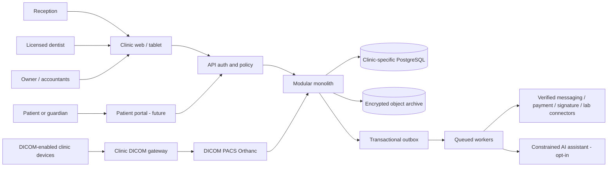

# System Architecture — Dental Practice + EMR + Treatment Journey

**Decision:** modular monolith initially, with isolated AI and integration workers. This document describes *target architecture*, not finished code. See `docs/PROJECT_STATE.md` to distinguish demo from approved clinical software.

## Context diagram

## Bounded context architecture
Domain modules: identity/organizations, patient registry, scheduling, clinical/EMR, odontogram, treatment journey, lab, inventory, financial ledger, patient engagement, analytics, integrations/audit. Each context owns its entity tables and writes through domain services; *other contexts don't modify its database rows directly.* The monolith can keep a single database transaction when needed, while use-cases raise outbox events for asynchronous effects.

## Deployment topologies
- **Local demo:** 127.0.0.1 only, SQLite + fake data, no auth, no real import.
- **Initial site pilot target:** isolated clinic DB, strong auth, encrypted archive, network segmentation, signed release, approved backup/restore, site-specific regulatory/legal signoff, staff training.
- **Commercial SaaS target:** shared stateless application pods, per-clinic logical DB (initial), tenant-aware worker routing, data-plane private networking, regional deployment review, central control-plane metadata excluding PHI where possible.
- **Dedicated option:** separately deployed application/DB for high-assurance client with measured support/upgrade costs.

## Transaction boundaries / outbox
Example appointment creation: verify clinician/clinic and patient → derive resource keys → DB transaction inserts Appointment + ResourceBooking rows → PostgreSQL exclusion constraint checks overlap → insert Audit and Outbox event in same DB transaction → commit → workers send approved patient notification, idempotently. No notification or external call before commit.

Example signed clinical note: receive authenticated doctor intent → validate note expected revision, approved form completeness, signer role → canonicalize snapshot → obtain approved signature evidence → atomic state transition and archive reference with recoverable failure handling. Legal correctness of external signature flow must be verified before release; do NOT implement atomic cryptographic claims with a fake boolean.

## Trade-off ADRs
- Modular monolith over services: easier transactions and traceability for a small team; clear interfaces allow later extraction.
- Relational domain core over raw FHIR DB: richer tooth/surface, resource booking and finance invariants; FHIR as adapter.
- Clinic-scoped database over shared tenant tables initially: simpler per-clinic backup/restore and safer failure radius, but many migrations and connection pools need management.
- Dedicated image archive/DICOM gateway: handle large media separately from transactional DB.
- AI queue/isolated service: core charting and scheduling must function when model unavailable.
- No broad offline synchronization until explicitly demanded and clinically validated.

## Scalability scenarios (not verified)
Initial 1–3 clinics: one application instance, one managed DB cluster with separate logical DBs, limited worker, archive and monitored backups. At 20–100 clinics: pooled connections, stateless replicas, queue workers, separate archival/media processing and DICOM gateway instances. Only adopt service extraction/Kubernetes after measured bottlenecks or isolation requirements.

## Observability
API/queue latency, error rate, scheduling conflicts, missing clinical attachment count, signature verification status (future), outbox dead letters, backup freshness and per-tenant SLA. Logs MUST NOT contain patient identity, clinical note text, payment identifiers, image metadata or AI prompt content. Use request correlation IDs and minimal redacted metadata.

## Failure handling
Timeout AI => manual note; lost messaging provider => retry with idempotency and customer-visible status; duplicate webhook => no duplicate ledger posting; DB fail => reject writes, no local fake success; archive unavailable => block completion requiring media; signature provider fail => keep draft unsealed; scheduling solver timeout => show current confirmed schedule unchanged.
